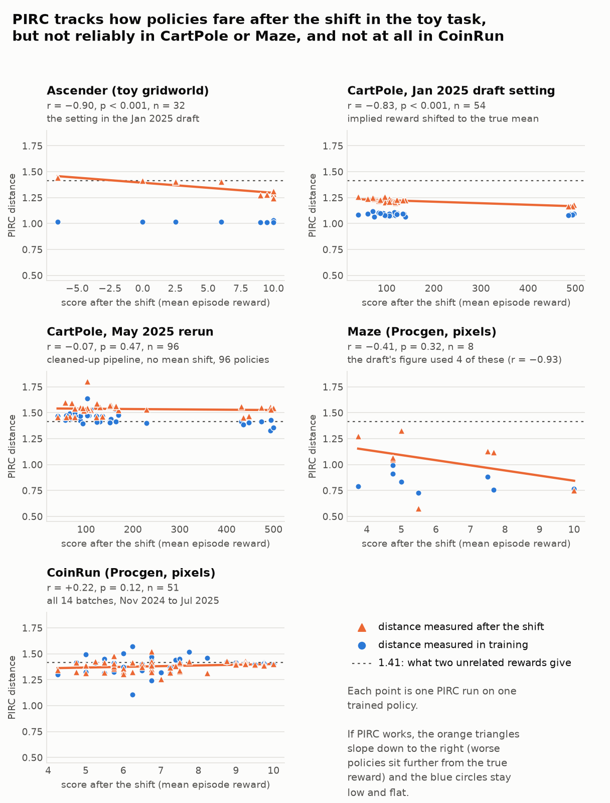
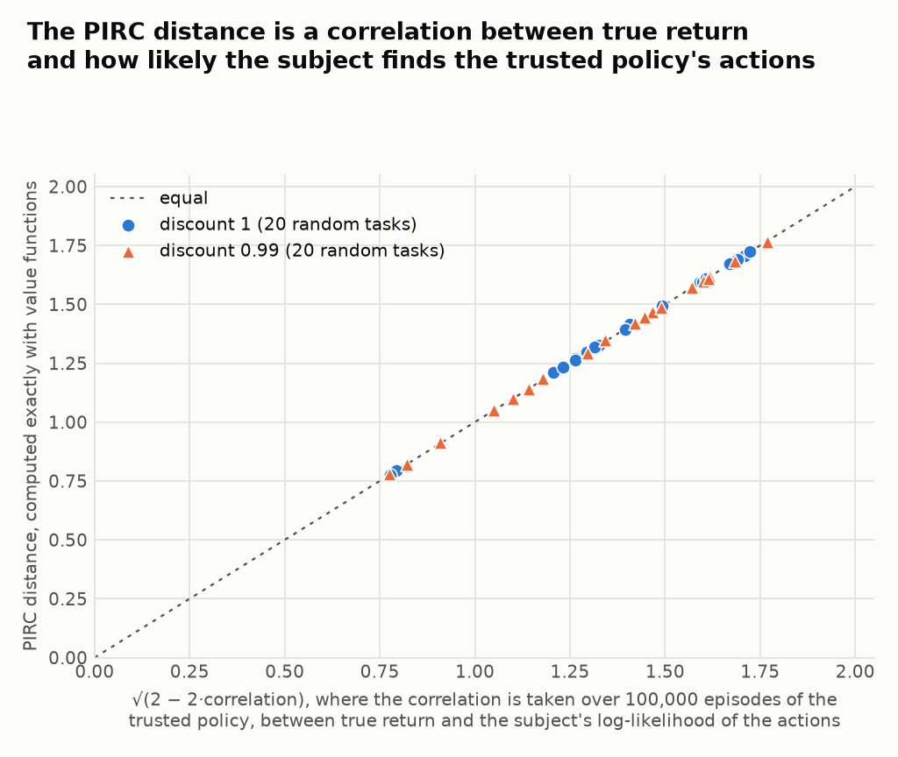
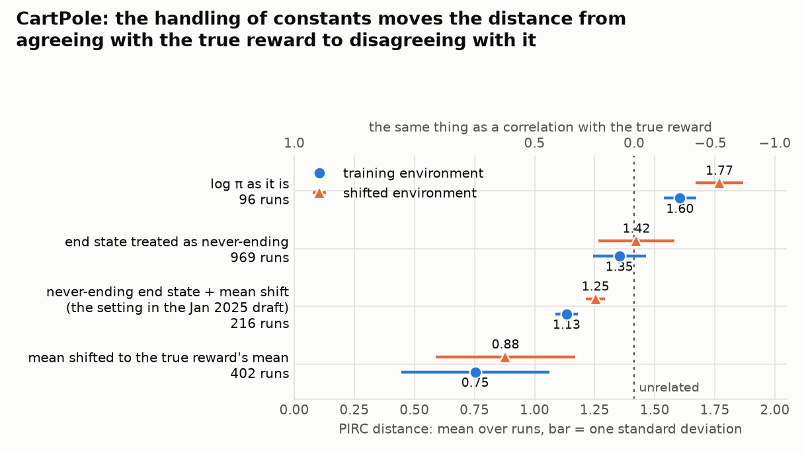

# PIRC: status and review (November 2026)

PIRC (Policy-Implied Reward Comparison) is the method this repository was built to test. It
reads a trained policy's action log-probabilities as a reward function and uses the distance
between that implied reward and the true reward to predict whether the policy will pursue the
wrong goal once the environment changes ("goal misgeneralisation"). This note records where
the work stands after a review of the code, the logged runs and the mathematics in November
2026. **Work on PIRC stopped at that point.** Nothing in the code was changed by the review.

Claims marked **[n]** are checked exactly, on small tabular tasks, by `verify_maths.py` in this
folder (Python 3.10 or later and `numpy`; it does not import the rest of the repository).

## 1. Summary

1. **Only the toy result is solid.** In Ascender the distance tracks how policies fare after
   the shift (correlation about −0.9). The CartPole and Maze results in the January 2025
   draft do not survive reruns, and CoinRun never showed a signal.
2. **The core theorem is correct and was already known.** A policy that is optimal for reward
   plus an entropy bonus has log-probabilities equal to the reward, up to changes that leave
   the ranking of policies alone.
3. **The distance this code computes is a correlation.** It equals `√(2 − 2ρ)`, where `ρ` is
   the correlation, across the trusted policy's episodes, between the true return of an
   episode and the subject policy's log-likelihood of the actions in it (exactly so without
   discounting; section 4). The value networks only supply a per-start-state average and
   reduce noise.
4. **That explains most of what the experiments did.** With sparse reward the effective sample
   is about the number of trusted episodes. The log-likelihood of random behaviour is mostly
   "minus a constant times episode length", so constants and the end-of-episode value drive
   the result.
5. **The method needs more than the stated assumption.** Every policy is optimal for reward
   plus entropy when the reward is its own log-probabilities. What is needed is that the
   log-probabilities of actions the policy never takes track how bad those actions are. The
   PPO settings used here do not produce that.
6. **For language models the mathematics becomes simple**, because text generation is a
   deterministic tree (section 7). What is left is a correlation between a grader's score and
   the log-likelihood ratio of a fine-tuned model to its base model, whose ingredients are all
   published.

## 2. What the code computes

One PIRC run handles one subject policy `π_s`, in a training environment and a shifted one.

| Step | Where |
|---|---|
| Collect rollouts with a trusted policy `π_t` (uniform random in almost every run) and store the subject's log-probability of each action taken | `agents/canonicalise.py`, `collect_rollouts` |
| Fit two value networks per environment by one-step temporal-difference regression on that data: `π_t`'s value under the true reward `R`, and under the implied reward `F` | `optimize_value` |
| Canonicalise each reward on the sampled transitions: `c(F) = F + γ·V_F(s') − V_F(s)` | `sample_and_canonicalise` |
| Divide each by its root-mean-square and take the root-mean-square difference `d`. Then `d² = 2 − 2·cos`: 0 for identical rewards, √2 for unrelated ones, 2 for opposite ones | `canonicalise_and_evaluate_efficient` |

The implied reward `F` is chosen by flags (named combinations are in `canon_clean.py`):

| Flags | `F(s,a)` |
|---|---|
| `soft_canonicalisation=True` ("soft") | `log π_s(a\|s)` |
| `soft_canonicalisation=False` ("hard") | `log π_s(a\|s) + H(s)`, the log-probability minus its policy-weighted mean (`H` is the entropy of `π_s` at `s`) |
| `centered_logprobs=True` ("hard centred") | `log π_s(a\|s)` minus its plain mean over actions |
| `adjust_logprob_mean=True` ("mean adjusted") | the above, shifted so its mean on the trusted data equals the true reward's mean |
| `infinite_value=True` ("inf") | the value of `F` at the end of an episode is set to `log(1/n)/(1−γ)` for `n` actions (about −2,700 for 15 actions and `γ = 0.999`) instead of 0 |

## 3. Results by environment

Counts are finished runs logged to Weights & Biases between November 2024 and September 2025
(7,453 PIRC runs in all). `r` is the correlation between the distance in the shifted
environment and the policy's score there; PIRC working means `r` strongly negative.

| Environment | Runs | What happened |
|---|---|---|
| Ascender (1-D gridworld, two features, one reversed after the shift) | 2,558 | Works. Draft figure `r = −0.90`. 16 of 20 batches with a uniform trusted policy give `r` between −0.65 and −0.96. With a tempered trusted policy the effect fades (`r = −0.53, −0.22, +0.05, +0.69`). Distances are compressed: about 1.0 in training, 1.28 for policies that generalise and 1.44 for those that do not |
| CartPole (physics parameters shifted) | 2,099 | Draft figure `r = −0.83` on 54 policies, in the soft, inf, mean-adjusted setting only. A sweep in May 2025 over 96 policies and five other settings gives `r` between −0.07 and +0.10. Later batches range from −0.14 to +0.77 |
| Maze (Procgen `maze_aisc`) | 134 | Draft figure: 4 policies, `r = −0.93`, `p = 0.07`. All 8 runs in that setting: `r = −0.41`, `p = 0.32`. One policy run twice gave 0.58 and 1.33. Sign unstable across batches |
| CoinRun (Procgen) | 51 | No signal. Distances sit near √2 in both environments for all 7 policies. In the last 20 runs (4 batches of 5 policies) the pooled `r` is +0.01 and reruns of one policy differ as much as policies differ from each other |
| Keys and chests (Procgen `heist_aisc_*`) | 0 | Never run |



## 4. What the distance measures

Write `c(F)_t` for the canonicalised reward on the transition at step `t` of a trusted episode.
It is the one-step surprise in the trusted policy's value under `F`, so its expectation given
the past is zero and surprises at different steps are uncorrelated. With `S_F = Σ_t c(F)_t`
summed over one episode,

```
E[ Σ_t c(F)_t · c(F')_t ] = Cov( S_F , S_F' ) .
```

The left-hand side is the inner product this code takes over the trusted data. So, with exact
value functions,

```
d = √(2 − 2ρ),     ρ = Corr over trusted episodes of ( S_R , S_F ) .
```

Without discounting, `S_F` is the episode's return under `F` minus the value of its start
state, so `ρ` is the correlation between the true return and `Σ_t log π_s(a_t|s_t)`, the
subject's log-likelihood of the episode's actions, each relative to its start state's mean.
With discounting the equal weighting used here and the discounted return differ by a factor
`γ^{2t}` on step `t`; they agree closely when episodes are short compared with `1/(1−γ²)`
(about 500 steps at `γ = 0.999`). **[7]**



*Forty random tasks. Horizontal: the distance from the correlation of returns over 100,000
sampled trusted episodes, with no value function. Vertical: the PIRC distance computed exactly.*

In words, PIRC asks whether the subject finds high-return random episodes more likely than
low-return random episodes. In the vocabulary of Gleave et al. (2021) this is their Episode
Return Correlation baseline, centred per start state, with `log π_s` as one of the two rewards.
Consequences:

- **Sample size.** When reward arrives once per episode the effective sample is about the
  number of trusted episodes, not the number of transitions. The last CoinRun runs had about
  48 episodes in training, which gives an uncertainty in `d` of roughly `1/√(2·48) ≈ 0.10`.
  Reruns of the same policy varied by about 0.10.
- **Episode length.** Under a uniform trusted policy each step contributes roughly a negative
  constant to the log-likelihood, so `Σ_t log π_s ≈ −c·(length)`. Any reward whose return goes
  with episode length under random play is correlated with that term for every subject alike.
- **Constants.** A constant added to the implied reward changes the length term. CartPole's
  true return is the episode length, and there the handling of constants alone moves the mean
  distance across most of its range:



*Logged CartPole runs with the soft reading. The four groups used different sets of policies.
On the 50 policies run both with `log π` as it is and with its mean shifted, the mean distance
in training is 1.60 against 0.86.*

- **Coverage.** `ρ` is a correlation over what the trusted policy does. If random play almost
  never does the thing that separates the intended goal from the proxy, the distance cannot
  see it.
- **Missing comparison.** With the same data, off-policy evaluation estimates the subject's
  return after the shift directly. The code logs importance-sampling estimates, but PIRC was
  not compared with them as a predictor.

The identity needs the canonical form on the *sampled* next state, as computed here. The
theorem in section 5 needs it averaged over the next state. Both hold together only when
transitions are deterministic. **[1]**

## 5. The theorem, and which reading of log π is exact

**Theorem (the paper's Theorem 3.1).** If `π` maximises reward plus entropy at temperature `α`,
then `α·log π(a|s) = E[R + γ·V_soft(s')] − V_soft(s)`: the reward after potential shaping,
averaging over the next state and scaling. A distance that ignores those three changes is zero.
**[1]** This is correct, and known (Cao, Cohen and Szpruch 2021; Watson, Huang and Heess 2023).

**The assumption cannot fail as stated.** Any policy is optimal for reward plus entropy when
the reward is its own log-probabilities, with soft value zero, under any dynamics. **[2]** What
can fail is that this reward is the *training* reward, under the regulariser and end-of-episode
convention used in the calculation. In the logged runs the distance in the training environment
is about 1.0 in Ascender and 1.4 in CoinRun, where the theorem would give 0.

**Four readings.** They differ in what is subtracted from `log π` in each state. Such a term is
not removed by canonicalisation. Each reading is exact for one kind of policy **[3]**:

| Subject policy | `log π` | `log π + H` | minus plain mean | minus maximum |
|---|---|---|---|---|
| Entropy inside the return | 0.000 | 0.030 | 0.046 | 0.065 |
| Per-state entropy bonus, exact policy gradient: `π = softmax(Q^π/β)` | 0.029 | 0.000 | 0.070 | 0.049 |
| Softmax of the uniform policy's Q-values | 0.046 | 0.071 | 0.000 | 0.079 |
| Softmax of the optimal Q-values (Boltzmann-rational) | 0.062 | 0.050 | 0.071 | 0.000 |

The plain-mean reading (`centered_logprobs`) is sometimes justified by "advantages sum to zero
over actions". That is false; only the policy-weighted sum is zero. None of the four is
derived for the PPO subjects trained here: with advantages normalised to unit variance
(`normalize_adv: True`) and an entropy coefficient of 0.01, a stationary point of the second
kind would need the variance of `log π` under the policy to be 10,000, and for 15 actions it
cannot exceed 2.6.

**Distance is not performance.** In an exact corridor task, a policy optimal for reward plus
entropy at a high temperature (close to random) has distance 0, while a near-optimal policy
whose log-probabilities are floored at −8 has distance 0.85 and almost the same return as the
exactly optimal one. **[4]** Skalse and Abate (2024, Theorem 3) prove the general version:
arbitrarily small changes in a policy can correspond to rewards at near-maximal distance.

## 6. The end-of-episode value

The right value of the implied reward at the end of an episode depends on how the subject was
regularised **[5]**:

- entropy bonus inside the return: 0 is exact, and no adjustment is needed;
- penalty for departing from uniform (no reward merely for staying alive): `−log(n)/(1−γ)` is
  exact, and is the same as adding `log n` to every step with end value 0;
- `+log(n)/(1−γ)` is exact for neither.

`inf_term_value` returned the positive value until commit `84cde03` (15 July 2025), so every
"inf" run before that date, including the draft's three figures, used it. A wrong choice costs
a distance that grows with the horizon, and only when episodes vary in length.

## 7. Language models: a deterministic tree

Take the state to be the prompt plus the tokens so far and the action to be the next token.
Every state has one parent and transitions are deterministic. Then **[6]**:

- two token-level rewards rank policies alike exactly when their totals over each complete
  text agree up to a constant per prompt and a common positive scale (Kim et al. 2021 call this
  trajectory equivalence);
- a model fine-tuned with a penalty `β` for moving away from a reference model has
  `Σ_t [log π − log π_ref] = (U(x) − V(prompt))/β` for every completion `x` with score `U`. This
  is the identity behind DPO (Rafailov et al. 2023; token level in Rafailov et al. 2024), and
  Mitchell et al. (2023) note that it defines an "implicit reward" for any fine-tuned model;
- the token-level PIRC distance equals `√(2 − 2ρ)` exactly, with `ρ` the correlation between
  `U(x)` and that log-likelihood ratio over completions sampled from the reference model. No
  value function is needed;
- goal-directedness measures that test whether `Q(s,a)` is a function of the next state only
  (the `meg` code paths here) are satisfied by every policy on a tree, because each next state
  has a single parent.

The result certifies agreement only on the completions used, and stochastic tool outputs or
user turns bring value estimates back.

## 8. Known issues in this code

Found by reading; none was confirmed or fixed by running.

| Issue | Where |
|---|---|
| The end-of-episode value had the wrong sign before 15 July 2025 (section 6) | `agents/canonicalise.py`, `inf_term_value` |
| Duplicate actions are merged into `dist` but the log-probability is not recomputed, so the merge has no effect | `agents/canonicalise.py`, `sample_and_canonicalise` (the line `# logp_batch = dist.log_prob(act_batch)`) |
| `collect_rollouts` does not return the latest observation, so each rollout starts with one stale action | `agents/canonicalise.py` |
| With a shared encoder, held-out next-state features are sliced from the wrong environments | `common/storage.py`, `collect_and_yield` |
| If the modified Procgen is not installed, `create_venv` falls back to stock Procgen with velocity markers painted, printing only "Using Real Procgen". Four of the seven CoinRun subjects, all trained after this fallback was added, score 2.75 to 7.25 in their own training environment although they trained to about 10, which may be this | `helper_local.py`, `create_venv` |
| Rewards pass through `VecNormalize` before PIRC sees them | `helper_local.py`, `create_venv` |
| The distance is computed over all environments, including those the value networks were fitted on | `agents/canonicalise.py` |
| `requirements.txt` does not install as written (PyYAML pinned twice; torch 2.1.0 with torchvision 0.19.1) and omits wandb, gymnasium, scipy, einops and the modified Procgen | `requirements.txt` |
| No tests cover the PIRC path | |

The `rohan` branch (29 commits past `main`, to September 2025) adds cluster scripts, more
trusted data per run and L1 distances; it was not reviewed in depth.

## 9. Reproducing

- `python docs/pirc/verify_maths.py` reproduces every bracketed check in a few seconds.
- `python docs/pirc/export_wandb_runs.py` writes one row per PIRC run to
  `docs/pirc/data/pirc_runs.csv` (not tracked; needs `wandb`, `pandas` and the untracked
  `private_login.py`). `python docs/pirc/make_figures.py` then redraws the three figures above
  (needs `numpy`, `pandas`, `scipy`, `matplotlib`; about a minute).
- One PIRC number: Python 3.8, the packages in `Readme.md` plus those missing from
  `requirements.txt`, the modified Procgen built from source, trained policies under `logs/`
  (not in this repository), then
  `python run_canonicalisation_new.py --env_name coinrun --model_dir <policy dir> --config soft_inf --suffix test`.
  Ascender needs no Procgen and runs in minutes.

## 10. References

- Cao, Cohen, Szpruch 2021. Identifiability in Inverse Reinforcement Learning. arXiv:2106.03498.
- Gleave et al. 2021. Quantifying Differences in Reward Functions. arXiv:2006.13900.
- Kim, Garg, Shiragur, Ermon 2021. Reward Identification in Inverse Reinforcement Learning. ICML.
- Langosco et al. 2022. Goal Misgeneralization in Deep Reinforcement Learning. arXiv:2105.14111.
- Mitchell et al. 2023. An Emulator for Fine-Tuning Large Language Models using Small Language Models. arXiv:2310.12962.
- Rafailov et al. 2023. Direct Preference Optimization. arXiv:2305.18290.
- Rafailov, Hejna, Park, Finn 2024. From r to Q*: Your Language Model is Secretly a Q-Function. arXiv:2404.12358.
- Skalse, Abate 2024. Quantifying the Sensitivity of Inverse Reinforcement Learning to Misspecification. arXiv:2403.06854.
- Skalse et al. 2023. Invariance in Policy Optimisation and Partial Identifiability in Reward Learning. arXiv:2203.07475.
- Skalse et al. 2024. STARC: A General Framework for Quantifying Differences Between Reward Functions. arXiv:2309.15257.
- Watson, Huang, Heess 2023. Coherent Soft Imitation Learning. arXiv:2305.16498.
